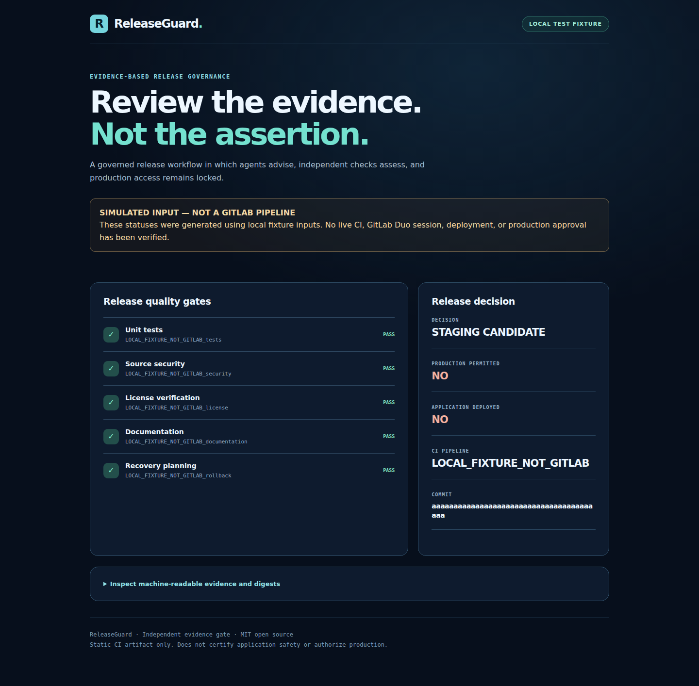

# ReleaseGuard — Evidence-first GitLab Duo release governance

**Status: Devpost registration confirmed; independent local candidate, NOT yet validated in organizer-provisioned GitLab workspace.**

ReleaseGuard demonstrates a governed AI DevSecOps workflow: investigate an MR,
independently check evidence, run security/licensing/testing gates, produce a
staging-candidate artifact, and obtain human acknowledgement. AI conclusions
are advisory; the release decision is deterministic.

Created for the **GitLab Transcend Life After Code** hackathon (October 2026).
This is an original, standalone MIT-licensed project and does not contain any
proprietary ATLAS code, internal infrastructure configurations or credentials.

## Evidence dashboard preview

The redesigned mobile-responsive dashboard is generated as a static GitLab CI
artifact. It shows test/security/license/documentation/rollback stage evidence,
the commit, pipeline provenance and an explicit no-production-permission
decision. The pictured report is a **LOCAL TEST FIXTURE**, not a live GitLab
pipeline or Duo run. Browser QA verifies five gates, accurate fixture warnings
and no horizontal overflow at 390 pixels.

## Competition presentation

- [Prepared Devpost submission text — NOT SUBMITTED](SUBMISSION_DRAFT.md)
- [2m30s real-evidence recording plan — VIDEO NOT YET RECORDED](DEMO_RUNBOOK.md)

Our intended entry is **Path A / Start Fresh / Assisted**. GitLab Duo
integration and actual GitLab CI history must be verified before submission.

## What it solves

Teams increasingly generate code faster than they verify it. Automated agents
can accidentally overstate passing tests, overlook secret leaks, or treat a
successful build as permission to deploy. ReleaseGuard makes these boundaries
visible: evidence is explicit, independent judgments are required, and a
staging candidate is never confused with a production deployment.

## Core controls

- Three proposed GitLab Duo agents: independent investigator, assessor and
  a restricted MR audit-note publisher, with HumanInputComponent approval.
  Only the exact approved route can reach the note publisher.
- Deterministic stage checks for tests, security, licensing, documentation
  and a written rollback plan.
- Exact source commit and evidence digests; rejecting paths that escape the
  repository or point to symlinks, sensitive files or embedded secrets.
- Three-way stage statuses: PASS, FAIL, UNVERIFIED. Missing evidence = NO_GO.
- Strict proposal schema. No action named deploy-production is accepted.
- Pipeline provenance hardening: a real GitLab gate requires a matching
  numeric pipeline ID, full CI_COMMIT_SHA, CI_JOB_STAGE and evidence source
  per stage. Local fixture evidence cannot pass --require-gitlab.
- Reject in-repository symlink paths, including symlinked parent directories.
- Human HMAC acknowledgement (only for staging candidates), never production.
- GitLab CI stages for testing, secret scanning, license checks, evidence
  collection, gating and a static, non-deployed staging artifact.

## Verified upstream CI job artifacts (candidate)

Rather than declaring every CI stage passed from environment flags alone,
the GitLab pipeline now downloads independent records from five successful
upstream jobs: tests, security, license, documentation, and rollback.
Each record identifies the exact GitLab job name, numeric job ID, pipeline
ID, full commit SHA, a PASS status, and a SHA-256 fingerprint of its source
evidence file. The evidence collector rejects missing, duplicate, mismatched,
or modified records. The final dashboard job downloads artifacts from
**both** the decision gate and the evidence collector.

These records are **not cryptographic GitLab attestations**: official GitLab
job history must still be independently checked. Local integration tests
intentionally use simulated CI environment variables and are not proof that
GitLab Duo or GitLab CI ran remotely.

- [First real GitLab CI acceptance checklist](CI_PRECHECK.md)
- [Independent CI-artifact tests](tests/test_ci_attestation.py)
- [Synthetic pipeline integration tests](tests/test_ci_pipeline_mock.py)

## Local test

No paid service, external API, model download or GPU required.

    python3 -m unittest discover -s tests -v
    python3 ci_security.py
    python3 ci_evidence.py
    python3 releaseguard.py check --root . --proposal release_proposal.json --evidence release_evidence.json --output release_decision.json
    python3 stage_preview.py

The local evidence file MUST say LOCAL_FIXTURE_NOT_GITLAB and is not a live
GitLab Duo result. The CI independent_gate job invokes --require-gitlab, which
fails closed outside a job with matching GitLab runtime identity.
A CI environment variable alone is not cryptographic attestation; verify
authentic pipeline history using the organizer-provisioned GitLab project. Real pipeline results require a project provisioned by
GitLab plus actual GitLab CI execution, with visible job and session history.

An adversarial demonstration:

1. In an isolated test fixture, mark security FAIL. The judge returns NO_GO.
2. Remove a required evidence stage. The judge refuses the schema.
3. Attempt an autonomous production action. The proposal is refused.
4. Provide valid local fixture evidence. The judge can issue STAGING_CANDIDATE
   with production_permitted=false and deployment_performed=false.
5. Have a separate human acknowledge staging evidence; this is not a deploy.

## GitLab Duo integration — unverified until onboarding

The candidate flow is at .gitlab/duo/flows/releaseguard.flow.yml.
Import it through GitLab project > AI > Flows > New flow, inspect and validate
the UI schema, then enable the flow for the project under its safe trigger.
The flow uses real GitLab Duo agents and a HumanInputComponent, but its YAML
file alone is NOT proof those agents ran. If the GitLab UI rejects any
configuration, correct it against current official docs before claiming success.

After contributor onboarding, import this repository into the provided
GitLab hackathon project. Run the GitLab pipeline, trigger Duo on an example
merge request, and capture authentic visible CI history and AI Sessions.

## Key limits

- No production deployment or rollback is implemented.
- The staging_preview stage creates a static artifact; it does not deploy.
- This minimal built-in regex scanner is not a substitute for enterprise SAST.
- Pipeline-bound evidence depends on protected, genuine GitLab CI jobs;
  local fixture claims are never treated as remote proof.
- The working GitLab Duo agent run, public GitLab repo, <3-minute public
  YouTube video and Devpost entry are still missing.
- Prize eligibility and a winning probability cannot be guaranteed.

## Competition

Official site: https://gitlab-transcend.devpost.com/
Official rules: https://gitlab-transcend.devpost.com/rules
GitLab access onboarding: https://contributors.gitlab.com/transcend-hackathon

The submission deadline is October 27, 2026 at 13:00 UTC
(9:00 AM Eastern Daylight Time). The binding rules take precedence
over other event pages if times differ.

Requirements include actual GitLab Duo Agent Platform use, visible GitLab CI
pipeline history, public MIT-licensed GitLab source, a public YouTube video
under three minutes and a completed Devpost submission.

No money was spent and no prize or client payment has been obtained.
